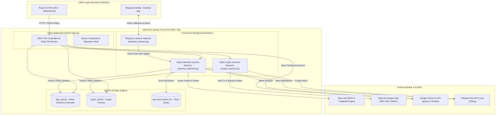
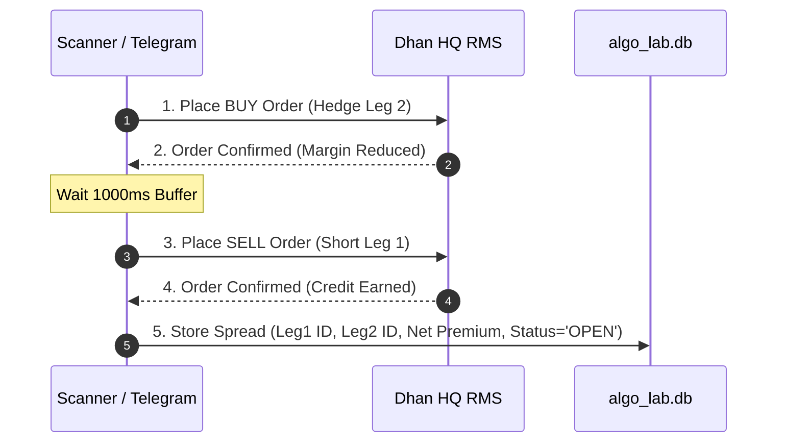
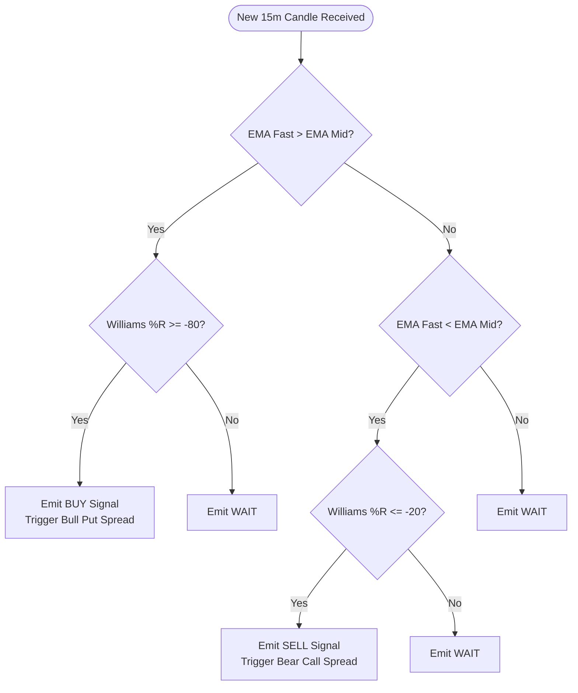

# Comprehensive Software Architecture & System Design Document
**Brand:** CodeTheMarket  
**Author:** Reev  
**Platform:** Multi-Asset Algo Trading Laboratory & Execution Engine  
**Markets:** Indian Equities & Derivatives (NSE / BSE / MCX via Dhan HQ) & Crypto Derivatives (Delta Exchange India)  
**Document Version:** 2.0 (Master Blueprint)

---

## Executive Summary & Educational Foundation

This document represents the exhaustive technical analysis and master architectural blueprint of the **CodeTheMarket Algo Trading Engine** authored by **Reev**. Designed as an institutional-grade, multi-market algorithmic trading and quantitative research platform, it bridges the gap between theoretical mathematical models and real-world high-speed execution.

This document serves as the single source of truth for:
1. The **"CodeTheMarket" Comprehensive Algo Trading Course** curriculum.
2. The companion **E-Book: "Building Institutional Algo Trading Engines with Python & React"**.
3. High-converting **Marketing Collateral & Product Demonstrations**.
4. Enterprise-grade open-source and proprietary software deployments.

---

## 1. System Architecture Overview

### 1.1 Architecture Pattern
The platform utilizes a **Hybrid Multi-Threaded Service Architecture**:
- **Backend Core**: Written in Python 3.10+ using **Flask**, executing concurrent background daemon threads for market data polling, strategy signal evaluation, bracket risk monitoring, and two-way Telegram event dispatching.
- **Frontend SPA**: A single-page application built on **React 19**, **Vite**, and **Tailwind CSS**, communicating asynchronously with the backend via RESTful JSON APIs.
- **Dual Embedded Persistence Layer**: Two isolated SQLite3 relational databases operating in multi-threaded WAL mode (`algo_lab.db` for Indian markets; `crypto_lab.db` for cryptocurrency futures).
- **Broker Abstraction Adapters**: Encapsulated broker communication layers interfacing with **Dhan HQ (OpenAPI v2)** and **Delta Exchange India REST API**.
- **Generative AI Layer**: Autonomous synthesis of market news and multi-symbol strategy summaries powered by **Google Gemini 1.5/2.5/3.8 Flash**.



### 1.2 Request / Response Lifecycle & Frontend-Backend Communication
1. **Decoupled Asynchronous Polling**:
   - The React frontend avoids brittle WebSocket reconnections over mobile networks by using an optimized **5-second polling cycle** against `/api/scanner/state`, `/api/scanner/paper_trades`, and `/api/crypto/state`.
   - Real-time technical indicators (LTP, EMA 5, EMA 15, Williams %R, Signals) are computed on the server side and cached in SQLite, ensuring browser requests resolve in under 15ms.
2. **Static Asset Delivery**:
   - The Vite build output (`frontend/dist`) is served directly by Flask via `app.py`'s static route handler.
   - SPA route rewrites in `app.py` guarantee seamless page reloads and deep linking across tabs (`/scanner`, `/screener`, `/historical`, `/backtest`, `/hedging`, `/crypto`, `/news`).
3. **Port & Host Configuration**:
   - Development: Port `5000` (Flask) with Vite dev server on port `5173`.
   - Production: Port `5000` bound to `0.0.0.0` or reverse-proxied via NGINX on Port `80`/`443`, managed by `systemd` (`algoscan.service`).

---

## 2. File-to-Feature Mapping Matrix

| File Path | Functional Role | Key Dependencies | Primary Responsibilities |
| :--- | :--- | :--- | :--- |
| `app.py` | Central Application Controller | Flask, dhanhq, requests, google-genai | Serves REST endpoints, routes React frontend, handles manual trade executions, coordinates backtests. |
| `scanner_backend.py` | Indian Markets Scanning Engine | Dhan-Tradehull, pandas, numpy | Monitors 50+ NSE stocks, indices (NIFTY, BANKNIFTY, SENSEX), and MCX commodities; calculates EMA/WPR; sends Telegram alerts. |
| `scanner.py` | Standalone CLI Prototype | Dhan-Tradehull | Headless command-line reference implementation for commodity and equity scanning. |
| `crypto_scanner.py` | 24/7 Delta Crypto Scanner | requests, hashlib, hmac | Monitors top 28 perpetual futures on Delta Exchange India; executes automated trailing P&L and bracket exits. |
| `telegram_listener.py` | Two-Way Mobile Execution Bot | requests, sqlite3 | Polls Telegram bot updates; parses inline button callbacks (`EXECUTE_`, `IGNORE_`, `EXIT_`) to fire live broker orders. |
| `backtester.py` | Single-Instrument Historical Engine | pandas, numpy, math | Simulates 7 core algorithmic strategies on CSV historical data with custom slippage, commissions, and trailing stop losses. |
| `hedging_backtester.py` | Multi-Leg F&O Hedging Engine | pandas, numpy | Builds synthetic Straddles, Strangles, Condors, Butterflies, and spreads; backtests expired options contracts. |
| `crypto_backtest.py` | Delta Perpetual Backtester | requests, pandas, numpy | Simulates high-leverage crypto perpetual futures trading with realistic taker fees (0.05% + 18% GST). |
| `api-scrip-master.csv` | Instrument Resolution Database | CSV (200k+ rows) | Resolves Dhan Security IDs, strike prices, lot sizes, and tick sizes for all Indian exchange segments. |
| `algo_lab.db` | Indian Markets Database | SQLite3 | Tracks credit spread positions, paper trades, live Dhan order IDs, and real-time scanner technical states. |
| `crypto_lab.db` | Crypto Database | SQLite3 | Tracks crypto perpetual futures positions, floating margin PnL, and 28-coin indicator states. |
| `frontend/src/` | React Single Page Application | React 19, Lucide, TailwindCSS | Unified graphical trading terminal featuring 9 interactive operational tabs. |

---

## 3. External API Integrations & Broker Architectures

### 3.1 Dhan HQ Broker Integration (Indian Markets)
The platform integrates with **Dhan HQ** (NSE, BSE, MCX) through two complementary libraries:
1. `dhanhq` (Official REST SDK): Used for portfolio queries, fund limits, and option chains.
2. `Dhan-Tradehull` (TSL Wrapper): Used for high-level tick retrieval, automated bracket orders, and option strike selection.

#### Authentication Mechanism
- Primary Auth: `DHAN_CLIENT_ID` + `DHAN_ACCESS_TOKEN`.
- Automated Headless Login (TOTP): When tokens expire daily at 06:00 IST, `scanner_backend.py` supports programmatic renewal via `DHAN_PIN` and `DHAN_TOTP_SECRET` using RFC 6238 TOTP algorithms.

#### Dynamic Option Strike Resolution Algorithm
To execute options credit spreads without hardcoding strike prices, `scanner_backend.py` implements a lookup against `api-scrip-master.csv`:
1. Determines underlying spot price ($S$).
2. Determines active Monthly Expiry: Filter where `SEM_EXPIRY_FLAG == 'M'`.
3. For Bullish Signal (**Bull Put Spread**):
   - **Leg 1 (Short Put)**: Strike $K_1 \approx S \times (1 - \text{OTM\%})$ (e.g., 2% OTM).
   - **Leg 2 (Long Hedge Put)**: Strike $K_2 = K_1 - \text{Spread Distance}$ (e.g., 200 points lower on Nifty).
4. For Bearish Signal (**Bear Call Spread**):
   - **Leg 1 (Short Call)**: Strike $K_1 \approx S \times (1 + \text{OTM\%})$.
   - **Leg 2 (Long Hedge Call)**: Strike $K_2 = K_1 + \text{Spread Distance}$.

#### Critical Sequential Margin Relief Execution
Exchange margin requirements for naked option selling are ₹1,20,000+ per lot, but a defined-risk spread requires only ~₹30,000. To ensure orders are never rejected for margin insufficiency, the execution engine enforces strict leg ordering:
```python
# Sequential Leg Execution Pattern (Dhan Margin Compliance)
# Step 1: BUY Hedge Leg FIRST (Reduces exchange margin requirement)
order_hedge = dhan.place_order(
    security_id=leg2_sec_id,
    exchange_segment=segment,
    transaction_type=dhan.BUY,
    quantity=qty,
    order_type=dhan.MARKET,
    product_type=dhan.MARGIN
)
time.sleep(1.0) # Buffer for broker risk engine acknowledgement

# Step 2: SELL Short Leg SECOND (Utilizes margin benefit)
order_short = dhan.place_order(
    security_id=leg1_sec_id,
    exchange_segment=segment,
    transaction_type=dhan.SELL,
    quantity=qty,
    order_type=dhan.MARKET,
    product_type=dhan.MARGIN
)
```



### 3.2 Delta Exchange India Integration (Crypto Derivatives)
- **Endpoint**: `https://api.india.delta.exchange`
- **Authentication**: HMAC SHA-256 Request Signing.
- **Header Structure**:
  - `api-key`: `DELTA_API_KEY`
  - `timestamp`: Unix timestamp in seconds.
  - `signature`: Hex-encoded HMAC-SHA256 of `METHOD + timestamp + path + query_string + body`.

#### Contract Sizing & 10x Isolated Leverage Formula
The engine allows users to commit a fixed INR capital (e.g., ₹10,000) per trade. The system automatically sizes the contract:
$$\text{USDT Margin} = \frac{\text{Capital INR}}{\text{USDT Rate (86.0)}} \approx 116.27 \text{ USDT}$$
$$\text{Position Notional Value} = \text{USDT Margin} \times \text{Leverage (10)} = 1162.79 \text{ USDT}$$
$$\text{Crypto Quantity} = \frac{\text{Position Notional Value}}{\text{LTP}}$$
$$\text{Contract Size} = \max\left(1, \text{round}\left(\frac{\text{Crypto Quantity}}{\text{Contract Value}}\right)\right)$$

### 3.3 Telegram Bot API & Mobile Trading Terminal
- **Bot Endpoint**: `https://api.telegram.org/bot<TOKEN>/`
- **Polling Loop**: Implemented in `telegram_listener.py` with `offset` tracking to prevent duplicate message handling.
- **Rich Message Dispatch with Inline Action Buttons**:
  When a signal triggers, a formatted notification with deep links is delivered directly to the user's phone:
```text
🚨 *NEW SIGNAL DETECTED* 🚨
Symbol: NIFTY50
Action: BUY (Bull Put Spread)
Spot Price: 24,840.50
Short Leg: 24800 PE @ 95.50
Hedge Leg: 24600 PE @ 35.20
Net Credit: 60.30 pts (₹1,507.50 / lot)
```
- **Inline Keyboards**:
  - `[ 🚀 Execute Live Trade ]` $\rightarrow$ Dispatches `EXECUTE_<ID>`.
  - `[ 🚫 Ignore Trade ]` $\rightarrow$ Dispatches `IGNORE_<ID>`.
  - `[ ❌ Square Off Position ]` $\rightarrow$ Dispatches `EXIT_<ID>`.

### 3.4 Google Gemini Generative AI Integration
- **SDK**: `google-genai` (New 2025/2026 unified Google Gen AI SDK)
- **Model**: `gemini-3.8-flash` (or `gemini-1.5-flash` fallback)
- **Use Cases**:
  1. **Batch Scanner Summary**: Synthesizes the state of 50 scanned stocks into an actionable 3-paragraph executive briefing.
  2. **Automated News Sentiment**: Ingests economic news headlines, classifies them into Bullish/Bearish sentiment, and estimates macroeconomic market impact.

---

## 4. Algorithmic Trading Strategies & Indicator Mathematics

### 4.1 The Core Production Strategy: EMA(5/15) + Williams %R(70)

The primary live engine combines a trend-following momentum filter with a multi-period overbought/oversold oscillator:

#### 1. Exponential Moving Average (EMA)
For a price series $P$ over smoothing window $N$:
$$\alpha = \frac{2}{N + 1}$$
$$\text{EMA}_t = \alpha \cdot P_t + (1 - \alpha) \cdot \text{EMA}_{t-1}$$
- **Fast EMA**: $N = 5$
- **Mid EMA**: $N = 15$
- **Slow EMA (Crypto Filter)**: $N = 50$

#### 2. Williams %R Oscillator
Measures where the current close is relative to the highest high and lowest low over the past $k = 70$ periods:
$$\%R = \frac{\text{Highest High}_{70} - \text{Close}_t}{\text{Highest High}_{70} - \text{Lowest Low}_{70}} \times (-100)$$
- Normal Range: `0` to `-100`.
- **Oversold Territory**: $\%R \le -80$.
- **Overbought Territory**: $\%R \ge -20$.

#### 3. Signal Generation Logic


### 4.2 Strategy Catalog in `backtester.py`

| Strategy Identifier | Mathematical Logic | Best Market Regime |
| :--- | :--- | :--- |
| `EMA_WPR` | 5/15 EMA crossover confirmed by Williams %R (70) threshold. | Trending with momentum confirmation. |
| `EMA_SIMPLE` | Pure 9 EMA crossing 21 EMA. | Strong trending markets. |
| `RSI_MR` | 14-period RSI < 30 (Buy) or > 70 (Sell) with mean reversion exit at 50. | Range-bound sideways markets. |
| `MACD_TF` | 12/26 MACD line crossing 9-period Signal line. | Medium-term trend following. |
| `BB_BREAKOUT` | 20-period Bollinger Bands (2 std dev); price piercing Upper/Lower bands. | Volatility expansion breakouts. |
| `OI_BREAKOUT` | Price breakout accompanied by >15% surge in Open Interest. | Institutional accumulation / distribution. |
| `WPR_CROSS_EMA` | Williams %R crossing its own moving average. | Early cycle momentum shifts. |

---

## 5. Backtesting Engines Architecture

### 5.1 Single-Instrument Historical Backtester (`backtester.py`)
- **Execution Architecture**: Reads CSV OHLCV historical bars into a Pandas DataFrame.
- **Realistic Friction Simulation**:
  - **Slippage**: Adjustable execution slippage (default 0.05% of price).
  - **Trailing Stop Loss**: Dynamic high-water mark trailing stops.
  - **Commissions & Brokerage**: Flat exchange fee modeling.
- **Output Metrics Computed**:
  - Total Cumulative Return (%)
  - Win Rate (%) & Profit Factor
  - Maximum Drawdown (%) & Drawdown Duration
  - Annualized Sharpe Ratio:
    $$\text{Sharpe} = \frac{\bar{R}_p - R_f}{\sigma_p} \times \sqrt{252}$$

### 5.2 Multi-Leg Options Hedging Backtester (`hedging_backtester.py`)
Backtests non-linear derivatives strategies across historical option contract series:
- **Long Straddle**: ATM Call + ATM Put.
- **Long Strangle**: OTM Call + OTM Put.
- **Bull Call Spread / Bear Put Spread**: Directional debit structures.
- **Iron Condor**: OTM Put Credit Spread + OTM Call Credit Spread.
- **Batman Strategy / Long Butterfly**: Multi-strike ratio structures with defined risk wings.

---

## 6. Frontend Architecture (React 19 SPA)

### 6.1 Directory Structure & Component Tree
```text
frontend/
├── package.json          # React 19, Lucide-react, TailwindCSS, Vite
├── vite.config.js        # Build configuration targeting dist/
├── index.html            # Single page entrypoint
└── src/
    ├── App.jsx           # Main tab router, dark/light theme provider
    ├── index.css         # Tailwind directives and custom CSS variables
    └── components/
        ├── HomeTab.jsx          # Metric cards, account funds, system telemetry
        ├── ScannerTab.jsx       # Real-time Indian markets scanner & paper ledger
        ├── ScreenerTab.jsx      # On-demand multi-indicator screener
        ├── HistoricalTab.jsx    # Dhan historical data fetcher & CSV exporter
        ├── BacktestTab.jsx      # Single-instrument backtester with equity charts
        ├── HedgingTab.jsx       # Multi-leg option builder & backtesting interface
        ├── CryptoScannerTab.jsx # Delta 28-coin perpetual futures scanner
        ├── CryptoBacktestTab.jsx# Delta crypto backtesting & leverage simulator
        └── NewsTab.jsx          # Gemini AI macroeconomic market intelligence
```

---

## 7. Configuration, Secrets & Environment Variables

| Variable Name | Required | Target Engine | Purpose & Format |
| :--- | :---: | :--- | :--- |
| `PORT` | Optional | Flask Web Server | Listening port (defaults to `5000`). |
| `DHAN_CLIENT_ID` | **Required** | Dhan HQ API | 10-digit numerical client identifier. |
| `DHAN_ACCESS_TOKEN`| **Required** | Dhan HQ API | JWT bearer token for API access. |
| `DHAN_PIN` | Optional | Dhan Headless Login | 6-digit numeric login PIN. |
| `DHAN_TOTP_SECRET` | Optional | Dhan Headless Login | Base32 TOTP secret for automated token renewals. |
| `DELTA_API_KEY` | **Required** | Delta Exchange India | REST API Key for crypto execution. |
| `DELTA_API_SECRET` | **Required** | Delta Exchange India | HMAC-SHA256 Secret Key for crypto signing. |
| `TELEGRAM_BOT_TOKEN`| **Required** | Telegram Alerts | HTTP Bot token provided by @BotFather. |
| `TELEGRAM_CHAT_ID` | **Required** | Telegram Alerts | Target Channel or User chat ID (e.g. `-100...`). |
| `GEMINI_API_KEY` | Optional | Google Gemini AI | API key for AI summaries and news intelligence. |

---

## 8. Enterprise Deployment Architecture

### 8.1 AWS Infrastructure Blueprint
- **Compute**: AWS EC2 `t3.micro` or `t3.small` instance running **Ubuntu 24.04 LTS** (eligible for Free Tier).
- **Networking**: Elastic IP attached for stable broker IP whitelisting; Security Group opening Port `80` (HTTP), `443` (HTTPS), and `22` (SSH).
- **Process Supervisor (`systemd`)**:
  ```ini
  [Unit]
  Description=CodeTheMarket Algo Trading Daemon
  After=network.target

  [Service]
  User=ubuntu
  WorkingDirectory=/home/ubuntu/algo-trading
  EnvironmentFile=/home/ubuntu/algo-trading/.env
  ExecStart=/home/ubuntu/algo-trading/venv/bin/gunicorn --workers 3 --bind 0.0.0.0:5000 app:app
  Restart=always
  RestartSec=5

  [Install]
  WantedBy=multi-user.target
  ```
- **Automated S3 Database Backup Pipeline (`backup_dbs.sh`)**:
  Executes an atomic SQLite backup every night at 23:59 IST using `sqlite3 .backup` and synchronizes encrypted archives to an AWS S3 bucket (`algo-trading-db-backups-99286`).

---

## 9. Course & Book Curriculum Blueprint: "CodeTheMarket" by Reev

This architecture document provides the direct structural foundation for the upcoming educational offerings:

### Module Structure:
- **Module 1**: Modern Algorithmic Architecture — Python Backend meets React Frontend.
- **Module 2**: Broker Protocol Engineering — Mastering Dhan HQ and Delta Exchange APIs.
- **Module 3**: Quantitative Strategy Design — EMA crossovers, Williams %R, and Multi-Timeframe filters.
- **Module 4**: Derivatives Engineering — Executing Bull Put & Bear Call Spreads with automated margin benefits.
- **Module 5**: 24/7 Crypto Futures Automation — Perpetual contracts, leverage management, and HMAC signing.
- **Module 6**: The Mobile Trading Terminal — Building two-way Telegram bots with interactive execution keyboards.
- **Module 7**: Rigorous Backtesting — Slippage, commissions, and non-linear options payoff modeling.
- **Module 8**: Cloud Deployment & Enterprise Reliability — AWS EC2, Gunicorn, systemd, and automated disaster recovery.
