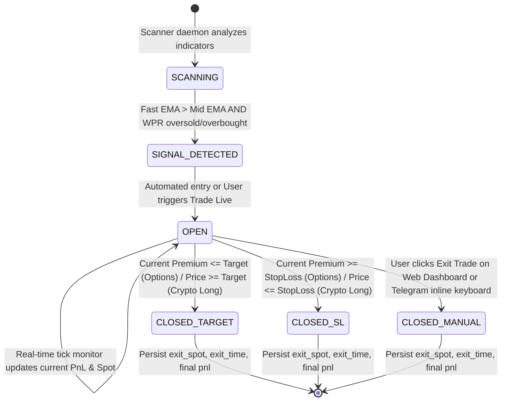

# Database Schema Documentation
**Brand:** CodeTheMarket  
**Author:** Reev  
**Platform:** Multi-Asset Algo Trading Laboratory & Execution Engine  
**Engines Covered:** Indian Equities & F&O (Dhan HQ), Crypto Derivatives (Delta Exchange India)

---

## 1. Overview & Architecture

The application employs an embedded, zero-configuration **SQLite3** relational database architecture split across two distinct database files to achieve clear domain separation:

1. **`algo_lab.db`**: Stores all state and trade execution lifecycle data for Indian markets:
   - Equity Stocks (NSE)
   - Benchmark Indices (NIFTY 50, BANKNIFTY, SENSEX)
   - MCX Commodity Mini Contracts (SILVERM, GOLDM, CRUDEOILM)
   - Multi-leg credit spreads (Bull Put Spread, Bear Call Spread)
2. **`crypto_lab.db`**: Stores state and perpetual futures trade execution data for Delta Exchange India:
   - Top-28 high-liquidity cryptocurrency perpetual contracts (BTC, ETH, SOL, XRP, etc.)

Both databases operate in Write-Ahead Logging (WAL) / multi-threaded connection mode, allowing background scanning daemon threads to update real-time state and trade P&L concurrently without blocking Flask web server API requests.

---

## 2. Database 1: `algo_lab.db` (Indian Markets)

### 2.1 Table: `paper_trades`

Stores the complete lifecycle of both simulated (paper) and live broker-placed option spread trades. Each row represents a two-legged credit spread (Short Strike + Long Strike Hedge).

#### Schema Definition (DDL)
```sql
CREATE TABLE IF NOT EXISTS paper_trades (
    id INTEGER PRIMARY KEY AUTOINCREMENT,
    symbol TEXT NOT NULL,
    trade_type TEXT NOT NULL,
    spread_type TEXT,
    leg1_symbol TEXT NOT NULL,
    leg2_symbol TEXT NOT NULL,
    lot_size INTEGER DEFAULT 1,
    entry_time TEXT NOT NULL,
    spot_entry REAL NOT NULL,
    leg1_entry_price REAL NOT NULL,
    leg2_entry_price REAL NOT NULL,
    net_premium_entry REAL NOT NULL,
    stop_loss REAL NOT NULL,
    target REAL NOT NULL,
    status TEXT NOT NULL,
    pnl REAL NOT NULL,
    exit_time TEXT,
    exit_spot REAL,
    leg1_exit_price REAL,
    leg2_exit_price REAL,
    net_premium_exit REAL,
    is_live INTEGER DEFAULT 0,
    live_leg1_order_id TEXT,
    live_leg2_order_id TEXT,
    live_exit_status TEXT
);
```

#### Field Specifications & Semantics

| Column Name | Data Type | Nullable | Default | Description & Business Rules |
| :--- | :--- | :--- | :--- | :--- |
| `id` | `INTEGER` | NO | Auto | Unique surrogate primary key. |
| `symbol` | `TEXT` | NO | - | Underlying instrument name (e.g., `RELIANCE`, `TCS`, `NIFTY50`, `BANKNIFTY`, `SENSEX`, `SILVERM`). |
| `trade_type` | `TEXT` | NO | - | Directional intent: `BUY` (Bullish market bias) or `SELL` (Bearish market bias). |
| `spread_type` | `TEXT` | YES | `NULL` | Strategy structure identifier: `'BULL_PUT_SPREAD'` (for BUY) or `'BEAR_CALL_SPREAD'` (for SELL). |
| `leg1_symbol` | `TEXT` | NO | - | Short leg option symbol sold for credit (e.g., `NIFTY 24OCT24 24500 PE` or `RELIANCE 28NOV24 1300 PE`). |
| `leg2_symbol` | `TEXT` | NO | - | Long leg option symbol bought as hedge (e.g., `NIFTY 24OCT24 24300 PE` or `RELIANCE 28NOV24 1280 PE`). |
| `lot_size` | `INTEGER` | NO | `1` | Number of lots traded. Multiplied by exchange contract multiplier for total quantity. |
| `entry_time` | `TEXT` | NO | - | ISO-8601 / formatted IST timestamp (`YYYY-MM-DD HH:MM:SS`) when position was entered. |
| `spot_entry` | `REAL` | NO | - | Underlying index/stock/commodity spot price at the time of trade execution. |
| `leg1_entry_price`| `REAL` | NO | - | Premium received for selling Leg 1 (Short Leg LTP). |
| `leg2_entry_price`| `REAL` | NO | - | Premium paid for buying Leg 2 (Hedge Leg LTP). |
| `net_premium_entry`| `REAL`| NO | - | Net Credit earned per unit: `leg1_entry_price - leg2_entry_price`. |
| `stop_loss` | `REAL` | NO | - | Stop-loss threshold in Net Premium terms (typically `entry_net_premium * 2.0`). |
| `target` | `REAL` | NO | - | Target threshold in Net Premium terms (typically `entry_net_premium * 0.20` or `0.00`). |
| `status` | `TEXT` | NO | - | Current state: `'OPEN'`, `'CLOSED_TARGET'`, `'CLOSED_SL'`, `'CLOSED_MANUAL'`. |
| `pnl` | `REAL` | NO | `0.0` | Accumulated Profit/Loss in INR: `(net_premium_entry - current_net_premium) * total_quantity`. |
| `exit_time` | `TEXT` | YES | `NULL` | Formatted IST timestamp (`YYYY-MM-DD HH:MM:SS`) when position was squared off. |
| `exit_spot` | `REAL` | YES | `NULL` | Underlying spot price at square off. |
| `leg1_exit_price` | `REAL` | YES | `NULL` | Premium paid to buy back short Leg 1 at square off. |
| `leg2_exit_price` | `REAL` | YES | `NULL` | Premium received from selling hedge Leg 2 at square off. |
| `net_premium_exit`| `REAL` | YES | `NULL` | Net cost per unit at square off: `leg1_exit_price - leg2_exit_price`. |
| `is_live` | `INTEGER`| NO | `0` | Execution mode flag: `0` = Paper Simulated Trade; `1` = Real Dhan Order Execution. |
| `live_leg1_order_id`| `TEXT`| YES | `NULL` | Broker order ID returned by Dhan API for Leg 1 (Short leg). |
| `live_leg2_order_id`| `TEXT`| YES | `NULL` | Broker order ID returned by Dhan API for Leg 2 (Hedge leg). |
| `live_exit_status`| `TEXT` | YES | `NULL` | Square-off execution record: `'SUCCESS'`, `'FAILED'`, or error message from broker. |

---

### 2.2 Table: `scan_state`

Maintains the live technical indicator cache for all tracked Indian equities, indices, and commodities. Polled continuously by the React frontend dashboard (`ScannerTab.jsx`).

#### Schema Definition (DDL)
```sql
CREATE TABLE IF NOT EXISTS scan_state (
    symbol TEXT PRIMARY KEY,
    ltp REAL,
    wpr REAL,
    ema_fast REAL,
    ema_mid REAL,
    signal TEXT,
    last_updated TEXT
);
```

#### Field Specifications & Semantics

| Column Name | Data Type | Constraints | Description |
| :--- | :--- | :--- | :--- |
| `symbol` | `TEXT` | PRIMARY KEY | Unique instrument symbol (e.g., `TCS`, `INFY`, `NIFTY50`, `SILVERM`). |
| `ltp` | `REAL` | - | Last Traded Price from live Dhan quote feed. |
| `wpr` | `REAL` | - | Williams %R calculated over 70 lookback periods. Values range from `0` to `-100`. |
| `ema_fast` | `REAL` | - | 5-period Exponential Moving Average on the active timeframe. |
| `ema_mid` | `REAL` | - | 15-period Exponential Moving Average on the active timeframe. |
| `signal` | `TEXT` | - | Current algorithmic state: `'BUY'`, `'SELL'`, or `'WAIT'`. |
| `last_updated` | `TEXT` | - | IST timestamp of the most recent evaluation cycle. |

---

## 3. Database 2: `crypto_lab.db` (Delta Exchange India)

### 3.1 Table: `crypto_trades`

Stores perpetual futures positions on Delta Exchange India (both paper tracking and real authenticated bracket orders).

#### Schema Definition (DDL)
```sql
CREATE TABLE IF NOT EXISTS crypto_trades (
    id INTEGER PRIMARY KEY AUTOINCREMENT,
    symbol TEXT NOT NULL,
    trade_type TEXT NOT NULL,
    entry_time TEXT NOT NULL,
    entry_price REAL NOT NULL,
    current_price REAL NOT NULL,
    stop_loss REAL NOT NULL,
    target REAL NOT NULL,
    status TEXT NOT NULL,
    pnl REAL NOT NULL,
    exit_time TEXT
);
```

#### Field Specifications & Semantics

| Column Name | Data Type | Nullable | Description & Business Rules |
| :--- | :--- | :--- | :--- |
| `id` | `INTEGER` | NO | Unique surrogate primary key. |
| `symbol` | `TEXT` | NO | Crypto asset base symbol (e.g., `BTC`, `ETH`, `SOL`, `XRP`). Maps to contract `symbol + "USD"`. |
| `trade_type` | `TEXT` | NO | Contract direction: `'LONG'` (Buy Futures) or `'SHORT'` (Sell Futures). |
| `entry_time` | `TEXT` | NO | IST timestamp of position execution. |
| `entry_price` | `REAL` | NO | Underlying contract fill price in USDT. |
| `current_price`| `REAL` | NO | Mark/LTP price updated on every 15-minute sweep cycle. |
| `stop_loss` | `REAL` | NO | Price level triggering stop-loss (default ±3% from entry or 30% on isolated margin). |
| `target` | `REAL` | NO | Price level triggering take-profit (default ±4% from entry or 40% on isolated margin). |
| `status` | `TEXT` | NO | Position lifecycle state: `'OPEN'`, `'CLOSED_TARGET'`, `'CLOSED_SL'`, `'CLOSED_MANUAL'`. |
| `pnl` | `REAL` | NO | Realized or floating P&L denominated in INR (calculated on 10x leverage position with standard USDT/INR conversion). |
| `exit_time` | `TEXT` | YES | IST timestamp when perpetual futures contract was closed. |

---

### 3.2 Table: `crypto_scan_state`

Maintains the live technical indicator calculations for all 28 tracked Delta Exchange perpetual contracts.

#### Schema Definition (DDL)
```sql
CREATE TABLE IF NOT EXISTS crypto_scan_state (
    symbol TEXT PRIMARY KEY,
    ltp REAL,
    wpr REAL,
    ema_fast REAL,
    ema_mid REAL,
    ema_slow REAL,
    signal TEXT,
    timestamp TEXT,
    last_sweep TEXT
);
```

#### Field Specifications & Semantics

| Column Name | Data Type | Constraints | Description |
| :--- | :--- | :--- | :--- |
| `symbol` | `TEXT` | PRIMARY KEY | Crypto contract base asset (e.g., `BTC`, `ETH`, `AVAX`). |
| `ltp` | `REAL` | - | Mark price / LTP fetched from Delta Exchange REST API (`/v2/tickers`). |
| `wpr` | `REAL` | - | Williams %R (70 periods) on 15m/1h candle series. |
| `ema_fast` | `REAL` | - | 5-period Exponential Moving Average. |
| `ema_mid` | `REAL` | - | 15-period Exponential Moving Average. |
| `ema_slow` | `REAL` | - | 50-period Exponential Moving Average (trend anchor). |
| `signal` | `TEXT` | - | Algorithmic status: `'BUY'`, `'SELL'`, or `'WAIT'`. |
| `timestamp` | `TEXT` | - | Candle timestamp from Delta API. |
| `last_sweep` | `TEXT` | - | IST timestamp of the scanner sweep cycle. |

---

## 4. Entity-Relationship & State Machine Models

### 4.1 Trade Status Lifecycle State Machine



### 4.2 Paper vs. Live Trade Discrimination Logic

The system maintains 100% architectural parity between paper trading and real live broker execution:

1. **Identification**:
   - In `paper_trades`: If `is_live == 0`, prices and execution updates are simulated using live Dhan API quote ticks (`get_ltp_data`). If `is_live == 1`, real orders are routed via Dhan API REST endpoints (`/orders`).
   - Order tracking IDs (`live_leg1_order_id`, `live_leg2_order_id`) store exchange order identifiers returned by Dhan.
2. **Sequential Risk Management**:
   - For live options credit spreads, Dhan margin benefits require strict ordering:
     1. Leg 2 (Hedge BUY) is placed first.
     2. Leg 1 (Short SELL) is placed second.
   - For square-off, Leg 1 (Short BUY back) is executed first, followed by Leg 2 (Hedge SELL).
3. **Database Clearing**:
   - Truncation endpoints (`/api/clear_paper_trades`, `/api/crypto/clear_trades`) allow users to reset their testing journal while preserving persistent indicator history in `scan_state` and `crypto_scan_state`.
